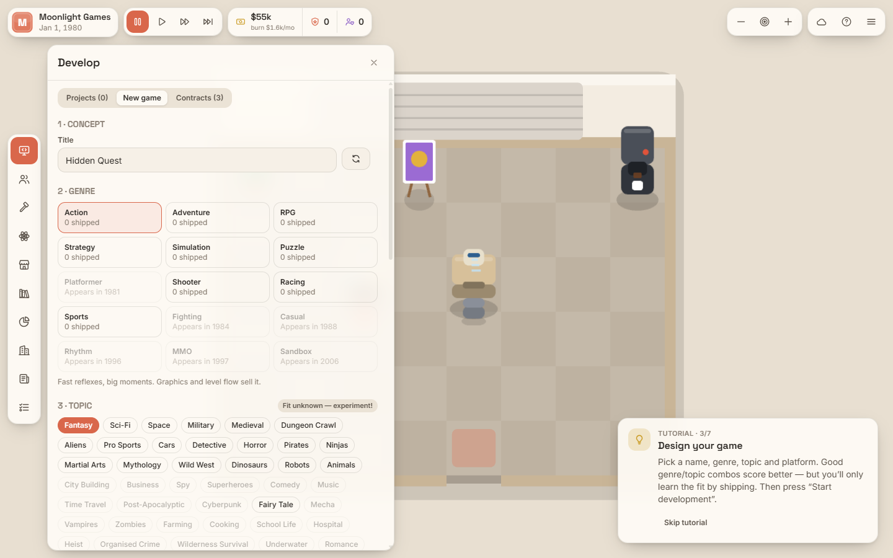
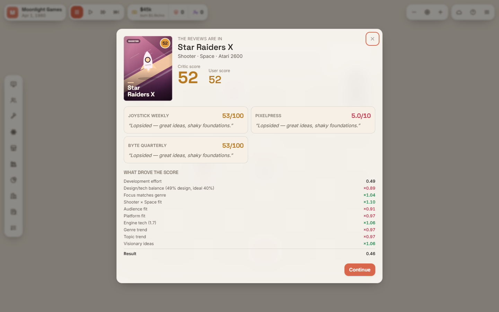
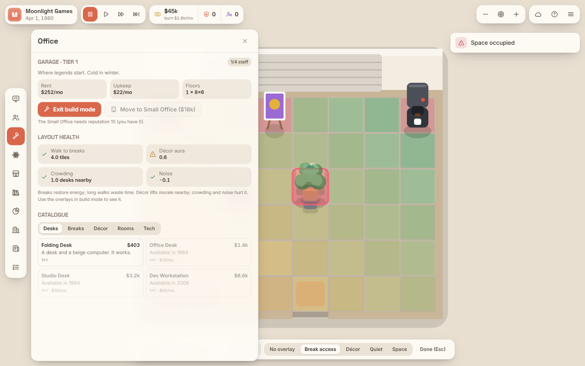
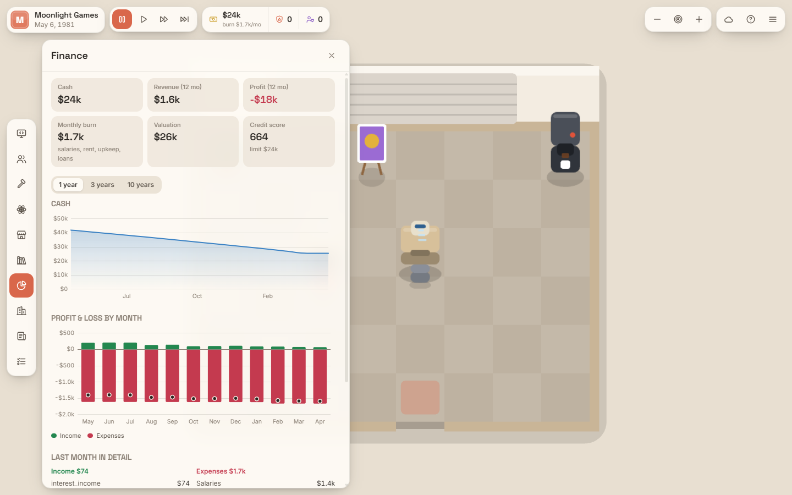
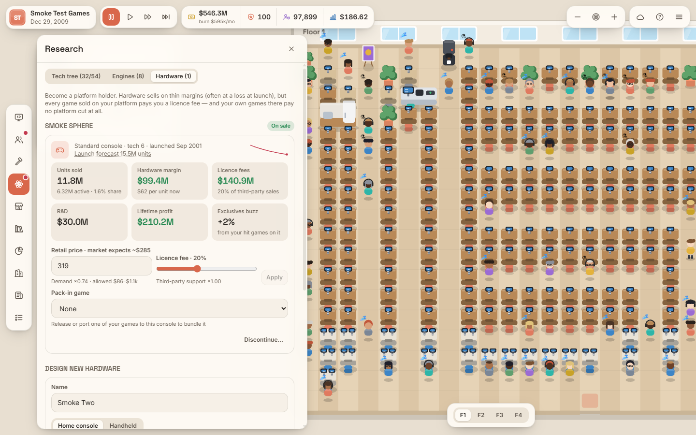
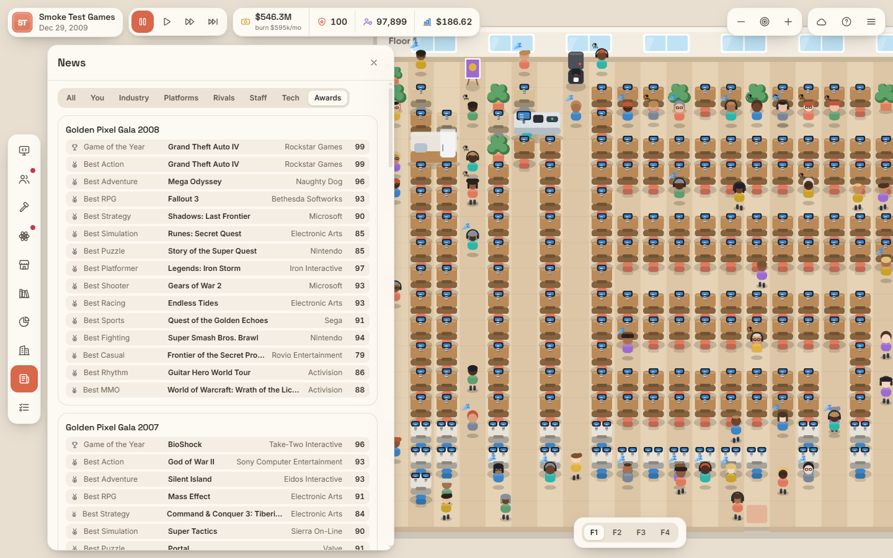
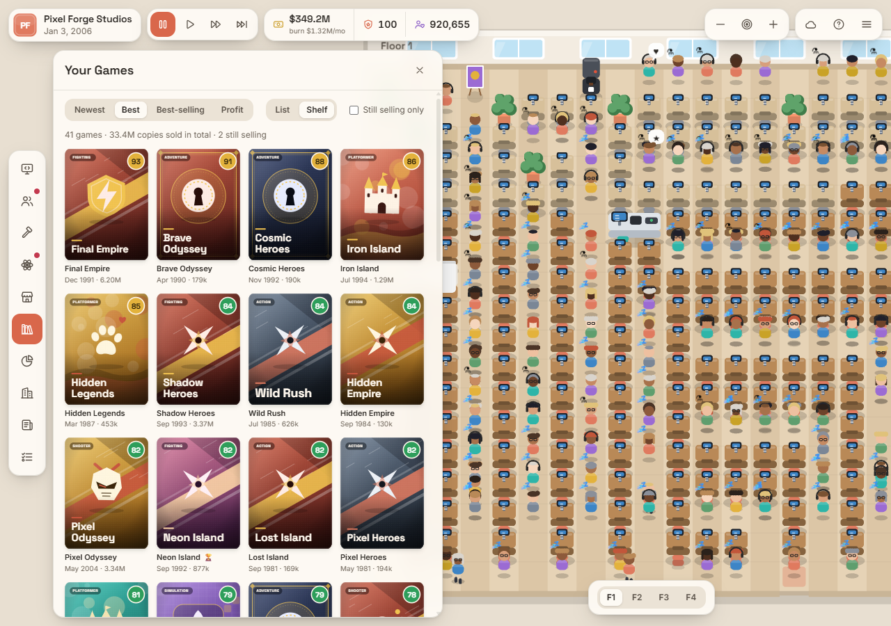
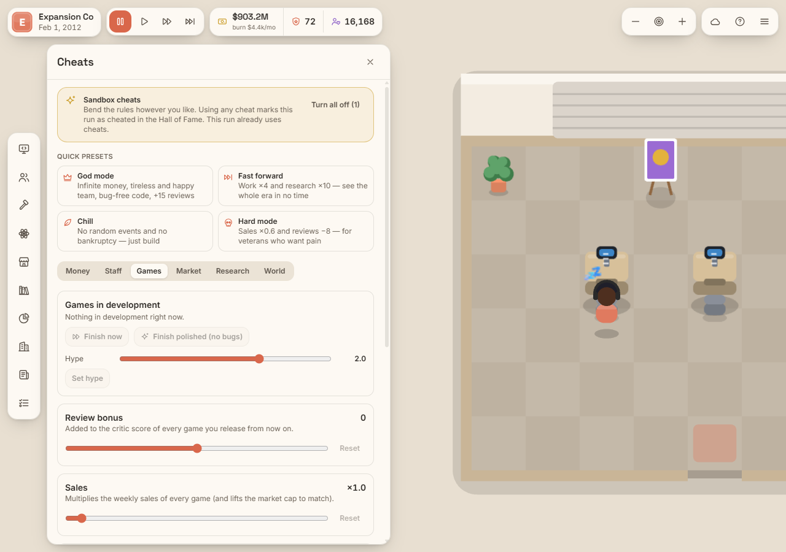

# Arnav Game Studio Empire

**Found a game studio in a 1980 garage and grow it into a global publisher.** A deep, browser-based game-company tycoon with a living top-down office, real platforms and rivals on their historical dates, and numbers that always tell you *why* they changed.


| Design a game | The reviews are in |
|---|---|
|  |  |
| **Shape your office** | **Run the business** |
|  |  |
| **Launch your own console** | **Win the Golden Pixel Gala** |
|  |  |
| **Your shelf of games** | **Bend every rule** |
|  |  |

## Features

- **46 years of real history.** Start in 1980 and live through 143 real industry events: the 1983 crash, the NES revival, the 3D revolution, Steam, the App Store, free-to-play, the pandemic boom and Switch 2. Endless mode then generates future hardware.
- **51 real platforms.** From the Atari 2600 to the Switch 2, each with an install-base curve, dev-kit costs, royalties, audiences and genre strengths.
- **75 real rival companies and 452 real games.** Real games from 99 franchises launch on their real dates and compete with you in the release window. Industry figures appear by name only, shown as initials badges. An all-time best-seller chart ranks your games against the real classics released so far.
- **A living office.**
  - Staff are drawn as vector sprites in PixiJS. They walk to the coffee machine, chat, crunch and slump when burnt out.
  - The layout really changes the numbers: break-area distance, décor auras, crowding and noise.
  - Heat-map overlays show each factor.
- **Deep development.**
  - Each game combines genre × topic × platform × audience × size × business model.
  - You set focus sliders per phase, then manage phase gates, bugs, QA, crunch, delays and cut features.
  - Engines can be custom-built or licensed, and there is a research tree with ~55 nodes.
- **Staff.** A hiring pool shaped by reputation, 18 traits, specialisations, morale, energy, burnout, vacations, loyalty, training, poaching and rare legendary hires.
- **Business.**
  - Publishing deals or self-publishing, contracts, marketing channels, trade shows and loans.
  - IPO, stock price and board, acquisitions and subsidiaries, and hostile takeovers.
  - Bankruptcy is a real fail state.
- **Reviews.** Critic outlets with their own biases and generated blurbs, user scores, franchises, fans, fatigue and yearly awards.
- **A living office.** Staff walk over to colleagues and chat in speech bubbles about what's really happening: your current game, last week's reviews, a rival's hit, crunch, awards, the new office, the era's tech. Their personalities and moods show. On breaks they play arcade games and ping-pong, lounge on sofas, browse bookshelves and gather at the water cooler. Seniors drop by juniors' desks to help, researchers think at whiteboards, workers show role-specific thoughts (a programmer's 🐛 when bugs pile up), and new hires say hello.
- **Characters that feel alive.** Every person has arms, eyes and a mouth: they blink and breathe, smile or frown with their mood, type, gesture while talking, sip coffee, wave hello, stretch, yawn, check their phone, facepalm at bugs, high-five friends, and dance or droop as reviews land. Visitors drop by (couriers, the pizza run during crunch, journalists, investors, interview candidates), and a Studio Cat or Office Dog roams the floor.
- **Seasons, birthdays and photos.** Snow on the windows, December lights and a tree, Halloween pumpkins, party balloons, staff birthdays with party hats — and Menu → Office photo saves a captioned picture of your studio.
- **Office ambience.** A generative soundscape: keyboards that follow how many people are working (clacky in the 80s), chatter, coffee, desk phones and the pets.
- **World regions & localisation.** North America, Europe, Japan and the rest of the world each have their own tastes and an era-shifting share of players. Choose your home region and localise games to reach players abroad.
- **Studio culture.** Pick up to two values (Quality First, Ship Fast, Player Obsessed, Profit Driven, Innovation, Work-Life Balance), each a real trade-off.
- **Staff ambitions.** People set personal goals with deadlines; help them for loyalty and morale, or watch them feel overlooked.
- **Shareholders.** Public studios face an annual meeting: dividends, bold growth promises and, if the board turns, a no-confidence vote.
- **Player buzz.** What players say about your games, in the medium of the era — magazine mailbags, bulletin boards, forums, social posts and streams.
- **Scenarios.** Seven curated challenges with their own start, team, goals and deadline, from *Garage Days* to the legendary *Empire*: survive the 1983 crash, build Japan's greatest RPG house, bet on 3D, win Game of the Year as a two-person indie.
- **Friendships, feuds and studio life.** Teammates grow close (better chemistry, happier) or clash into feuds you have to handle. Employee of the Month, yearly team retreats, birthdays, farewells when people leave, and credits on every game.
- **Live events and branch offices.** Run seasonal events in live games; open studios abroad for free localisation and local know-how.
- **Cinematic mode and office style.** Press V to hide the interface and let the camera wander the office; choose your floor and wall colours; build foosball, a claw machine, a guitar corner and a statue of your series' mascot. Desk monitors show each person's work.
- **Mentors, unions and conventions.** Pair juniors with seniors to grow them faster; heavy crunch can spark a union drive; big series host their own fan conventions; rivals rush out knock-offs of your hits; indie studios that close send their developers your way.
- **A bug bash mini-game.** During polish, squash bugs for 20 seconds to fix up to a quarter of them.
- **More to build and make.** A gym that slows burnout, hammocks, a karaoke machine, foosball and more; four extra topics (Trains, Witches & Wizards, Giant Monsters, Cozy Village) with their own cover art.
- **Runs a big studio without busywork.**
  - **Studio Overview (O):** lists everything that needs attention, each with a one-click fix.
  - **Team tab:** filters, search, grouping and compact rows for hundreds of people, plus bulk actions (assign, research, vacation, training, raises).
  - **Team pickers:** every one has search and a "Best team" option ranked by fit for the job.
  - **Hiring:** hire several people at once.
  - **Building:** drag to place a row of furniture, or click "Desks for everyone".
  - **Automation policies:** idle staff research, burnt-out staff go on vacation, and research keeps going.
- **Signature features.** Give each game up to three features (open world, online multiplayer, branching story, battle pass and more), each unlocked in its era. They add scope and pay off in the genres they suit.
- **Launch titles and expectations.** Ship in a platform's first months to sell to starved early adopters. Sequels are judged against the series' best, so disappoint the fans and some drift away.
- **Open betas.** From 2005, test with real players during polish: fewer bugs, more hype and an early read on the score.
- **A studio that ages.** Veterans retire after 30–40 years with a farewell party and join your alumni. Each decade ends with a look back at its Games of the Year, and winning a Golden Pixel award gets you a proper ceremony.
- **Your identity.** Click your badge to rename the studio and pick its colour, shape and emblem.
- **Rivalries.** Launch near a rival's game in the same genre and the press calls a showdown. You build a win/loss record with every studio, and the one you clash with most becomes your nemesis.
- **Esports leagues.** From 2009, run a regional circuit, pro league or world championship for a competitive hit. Viewers grow with prestige season after season; sponsors pay per viewer, prize pools cost money, and leagues follow your franchise to a strong sequel.
- **Generative soundtrack.** Music is synthesized live with WebAudio (no audio files) and follows the era: square-wave chiptune in the 1980s, FM bells in the 1990s, soft synth pads in the 2000s and swung lo-fi beats from 2012. It has its own toggle and volume in Settings.
- **Cheats sandbox.** Tick *Sandbox mode* when founding a studio for infinite money, free building and no bankruptcy from day one, or open Menu → Cheats (or press `) in any game: set or add cash, reputation and fans, forgive loans, edit staff stats and traits or summon custom hires, strengthen or cripple rivals, set genre and topic trends, finish games instantly, set review bonuses and sales, work and research multipliers, unlock research (even future tech), skip time, jump to any office, and switch on infinite money, no bankruptcy, a tireless team, bug-free code, free building or no random events. Cheated runs are marked in the Hall of Fame.
- **Post-launch.** Patch buggy games to win players back, port hits to new platforms, make up to two expansion packs for a recent hit (they sell to its owners and bring lapsed players back), run storefront sales in the digital era, or remaster an 8-year-old classic for half the work. Holiday seasons sell, January slumps.
- **Publishing label.** Fund indie studios' games for a share of the revenue. Pick talent, set the budget and hope for a hit.
- **Subscription pass.** Turn a strong back catalogue into recurring revenue with your own all-you-can-play pass. Price it right and keep shipping good games, but watch older-game sales and server bills.
- **Your own console.** Research the Hardware Lab, then design a console or handheld: choose its tier, price, licence fee and launch campaign. It becomes a real platform with its own install base and market share. Hardware sells near cost, while licence fees, royalty-free exclusives and a pack-in hit are where the money is. Faults, piracy and retail bundle deals keep you on your toes.
- **Rival poaching, both ways.** Rivals try to lure your stars; with Headhunters research you can poach theirs.
- **45 choice events** with real trade-offs: crunch exposés, review bombs, streamer spotlights, leaked builds, speedrun records, a studio cat, exclusivity offers, crowdfunding, buyouts, hostile takeovers, Hollywood adaptations and more.
- **Explainable numbers.** Every key number (productivity, morale, review score, sales, cash flow) has a "why" breakdown on hover.
- **Accounts & saves.**
  - Email/password, Google sign-in or guest play, with five save slots.
  - Saves land locally first (IndexedDB), then sync to the cloud (Firestore) with versioned, compressed, chunked data.
  - Offline play and conflict resolution are supported.
- **Save files.** Export any slot to a JSON file and import it into another browser or device. Useful for guest players, whose saves otherwise live in one browser.
- **Polish.** Light/dark themes, reduced motion, keyboard shortcuts, an interactive tutorial, an in-game guide, a year-in-review card, synthesized sound with a mute option, offline support (service worker), and responsive layouts for desktop and tablet.
- **Original art only.** All art is hand-built SVG or procedural code: no AI-generated images, no real logos and no likenesses.

## Tech

| | |
|---|---|
| App | Vite · React 19 · TypeScript (strict) · Tailwind CSS 4 · Zustand |
| Rendering | PixiJS 8 (procedural vector sprites, generated textures) |
| Simulation | Pure, deterministic TypeScript (`src/sim`): seeded RNG, 1-day fixed tick, no UI imports |
| Backend | Firebase Auth + Firestore (strict per-user security rules) |
| Hosting | Cloudflare Pages |
| Tests | Vitest: unit and system-edge tests, Firestore rules tests (emulator), 46-year headless bot playthroughs |

The design is documented in [`docs/DESIGN.md`](docs/DESIGN.md), [`docs/BUILD_PLAN.md`](docs/BUILD_PLAN.md) and [`docs/ART.md`](docs/ART.md).

## Local setup

```bash
npm install
cp .env.example .env      # fill in your Firebase web config (or leave empty to play as guest only)
npm run dev               # http://localhost:5173
```

Useful scripts:

| Script | What it does |
|---|---|
| `npm test` | Unit, system and 46-year bot playthrough tests |
| `npm run test:rules` | Firestore security rules tests (starts the emulator; needs Java) |
| `npm run balance` | Balance report across bot strategies and seeds (`reports/balance.md`) |
| `npm run dev:emulators` | Auth + Firestore emulators; run the app with `VITE_USE_EMULATORS=true` |
| `npm run build` | Typecheck and production build to `dist/` |

### Deploying

```bash
npm run build
npx wrangler pages deploy dist --project-name arnav-game-studio-sim
firebase deploy --only firestore:rules
```

Add your Pages domain to **Firebase Console → Authentication → Settings → Authorized domains**, and enable the **Email/Password** and **Google** sign-in providers.

## Project layout

```
src/
  data/      typed historical & tuning data (platforms, companies, franchises, events, balance…)
  sim/       the deterministic simulation engine (systems/, actions, advance, save/migrations)
  render/    PixiJS office renderer
  ui/        React app: screens, panels, modals, charts, art kit, store
  services/  Firebase, auth, local/cloud saves
tests/       sim, data, rules and bot playthrough tests
```

## Known limitations

- **Sign-in providers.** Online accounts need the Email/Password and Google providers enabled in the Firebase console, plus the live domain in Authorized domains. Until then the live site works in guest mode, with saves kept on the device.
- **Hall of Fame scope.** It is per player. Strict per-user security rules mean there is no global leaderboard.
- **Rivals.** Rival AI is abstracted: monthly releases with strategy-driven scores and real franchises on their dates. Rivals don't manage offices or staff like the player does.
- **Subsidiaries.** Acquired studios run on autopilot. You set their budget and genre focus only.
- **Your hardware.** Third-party support for your console is modelled as licence fees that scale with its user base. Real rival franchises never appear on it, and rival studios' games on it are abstract.
- **Publishing label and pass.** Indie games you publish are scored and sold by a compact model rather than a full development simulation. The subscription pass is one monthly price, with no tiers or regional pricing.
- **Phones.** The game is playable on phones, but it's best on tablet or desktop screens.
- **Accessibility.** Keyboard and screen-reader support covers menus, panels, modals and charts, and furniture can be placed with the arrow keys and Enter. Panning the office by drag needs a pointer (or use W A S D).

## Disclaimer

This is a work of simulation. Real company, platform, game and people names are used as historical references only. No logos, artwork, characters or likenesses are reproduced, and no endorsement is implied.

## License

[MIT](LICENSE)
