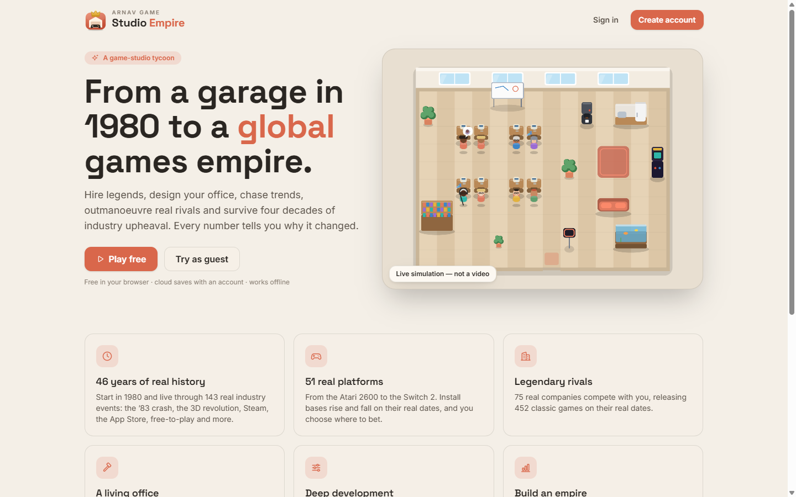

# Arnav Game Studio Empire

**Found a game studio in a 1980 garage and grow it into a global publisher.** A deep, browser-based game-company tycoon with a living top-down office, real platforms and rivals on their historical dates, and numbers that always tell you *why* they changed.



| Design a game | The reviews are in |
|---|---|
|  |  |
| **Shape your office** | **Run the business** |
|  |  |

## Features

- **46 years of real history.** Start in 1980 and live through 143 real industry events: the 1983 crash, the NES revival, the 3D revolution, Steam, the App Store, free-to-play, the pandemic boom and Switch 2. Endless mode then generates future hardware.
- **51 real platforms.** From the Atari 2600 to the Switch 2, each with an install-base curve, dev-kit costs, royalties, audiences and genre strengths.
- **75 real rival companies and 452 real games.** Real games from 99 franchises launch on their real dates and compete with you in the release window. Industry figures appear by name only, shown as initials badges.
- **A living office.**
  - Staff are drawn as vector sprites in PixiJS. They walk to the coffee machine, chat, crunch and slump when burnt out.
  - The layout really changes the numbers: break-area distance, décor auras, crowding and noise.
  - Heat-map overlays show each factor.
- **Deep development.**
  - Each game combines genre × topic × platform × audience × size × business model.
  - You set focus sliders per phase, then manage phase gates, bugs, QA, crunch, delays and cut features.
  - Engines can be custom-built or licensed, and there is a research tree with ~55 nodes.
- **Staff.** A hiring pool shaped by reputation, 18 traits, specialisations, morale, energy, burnout, loyalty, training, poaching and rare legendary hires.
- **Business.**
  - Publishing deals or self-publishing, contracts, marketing channels, trade shows and loans.
  - IPO, stock price and board, acquisitions and subsidiaries, and hostile takeovers.
  - Bankruptcy is a real fail state.
- **Reviews.** Critic outlets with their own biases and generated blurbs, user scores, franchises, fans, fatigue and yearly awards.
- **Post-launch.** Patch buggy games to win players back, or port hits to new platforms. Holiday seasons sell, January slumps.
- **Rival poaching, both ways.** Rivals try to lure your stars; with Headhunters research you can poach theirs.
- **32 choice events** with real trade-offs: crunch exposés, review bombs, exclusivity offers, crowdfunding, buyouts, hostile takeovers and more.
- **Explainable numbers.** Every key number (productivity, morale, review score, sales, cash flow) has a "why" breakdown on hover.
- **Accounts & saves.**
  - Email/password, Google sign-in or guest play, with five save slots.
  - Saves land locally first (IndexedDB), then sync to the cloud (Firestore) with versioned, compressed, chunked data.
  - Offline play and conflict resolution are supported.
- **Polish.** Light/dark themes, reduced motion, keyboard shortcuts, an interactive tutorial, an in-game guide, a year-in-review card, synthesized sound with a mute option, offline support (service worker), and responsive layouts for desktop and tablet.
- **Original art only.** All art is hand-built SVG or procedural code: no AI-generated images, no real logos and no likenesses.

## Tech

| | |
|---|---|
| App | Vite · React 19 · TypeScript (strict) · Tailwind CSS 4 · Zustand |
| Rendering | PixiJS 8 (procedural vector sprites, generated textures) |
| Simulation | Pure, deterministic TypeScript (`src/sim`): seeded RNG, 1-day fixed tick, no UI imports |
| Backend | Firebase Auth + Firestore (strict per-user security rules) |
| Hosting | Cloudflare Pages |
| Tests | Vitest: unit and system-edge tests, Firestore rules tests (emulator), 46-year headless bot playthroughs |

The design is documented in [`docs/DESIGN.md`](docs/DESIGN.md), [`docs/BUILD_PLAN.md`](docs/BUILD_PLAN.md) and [`docs/ART.md`](docs/ART.md).

## Local setup

```bash
npm install
cp .env.example .env      # fill in your Firebase web config (or leave empty to play as guest only)
npm run dev               # http://localhost:5173
```

Useful scripts:

| Script | What it does |
|---|---|
| `npm test` | Unit, system and 46-year bot playthrough tests |
| `npm run test:rules` | Firestore security rules tests (starts the emulator; needs Java) |
| `npm run balance` | Balance report across bot strategies and seeds (`reports/balance.md`) |
| `npm run dev:emulators` | Auth + Firestore emulators; run the app with `VITE_USE_EMULATORS=true` |
| `npm run build` | Typecheck and production build to `dist/` |

### Deploying

```bash
npm run build
npx wrangler pages deploy dist --project-name arnav-game-studio-sim
firebase deploy --only firestore:rules
```

Add your Pages domain to **Firebase Console → Authentication → Settings → Authorized domains**, and enable the **Email/Password** and **Google** sign-in providers.

## Project layout

```
src/
  data/      typed historical & tuning data (platforms, companies, franchises, events, balance…)
  sim/       the deterministic simulation engine (systems/, actions, advance, save/migrations)
  render/    PixiJS office renderer
  ui/        React app: screens, panels, modals, charts, art kit, store
  services/  Firebase, auth, local/cloud saves
tests/       sim, data, rules and bot playthrough tests
```

## Known limitations

- **Sign-in providers.** Online accounts need the Email/Password and Google providers enabled in the Firebase console, plus the live domain in Authorized domains. Until then the live site works in guest mode, with saves kept on the device.
- **Hall of Fame scope.** It is per player. Strict per-user security rules mean there is no global leaderboard.
- **Rivals.** Rival AI is abstracted: monthly releases with strategy-driven scores and real franchises on their dates. Rivals don't manage offices or staff like the player does.
- **Subsidiaries.** Acquired studios run on autopilot. You set their budget and genre focus only.
- **Phones.** The game is playable on phones, but it's best on tablet or desktop screens.
- **Accessibility.** Keyboard and screen-reader support covers menus, panels, modals and charts, and furniture can be placed with the arrow keys and Enter. Panning the office by drag needs a pointer (or use W A S D).

## Disclaimer

This is a work of simulation. Real company, platform, game and people names are used as historical references only. No logos, artwork, characters or likenesses are reproduced, and no endorsement is implied.

## License

[MIT](LICENSE)
