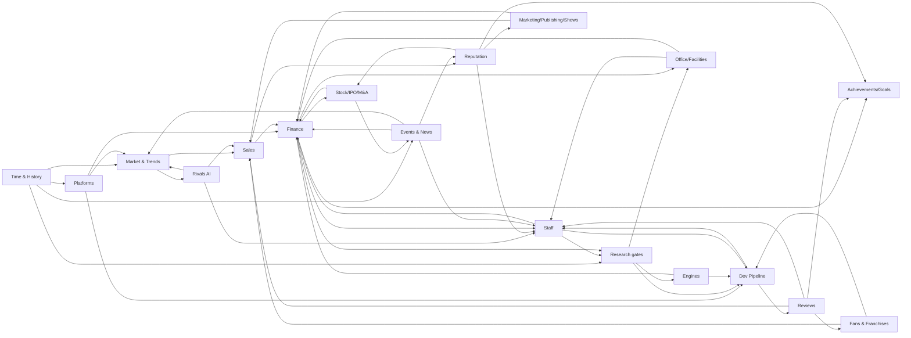

# Arnav Game Studio Empire — Design Document

Status: **Draft for approval** · Schema version target: `1` · Last updated: 2026-11-16

---

## 1. Pitch

Found a two-person game studio in a garage in January 1980. Ride (or get crushed by) 46 years of real industry history: the Atari boom, the 1983 crash, the NES revival, the 3D revolution, CD-ROM, online, Steam, the App Store, free-to-play, live service, and whatever comes next. Hire people, design the office they work in, research tech, build engines, ship games, build franchises, go public, buy rivals, or go bankrupt trying.

Inspirations for depth: Game Dev Tycoon, Mad Games Tycoon. What we add:
- a **living top-down office** where layout really affects the numbers;
- **real platforms and companies** as data, on historical dates;
- tooltips that explain **why** each number changed.

---

## 2. Core loop

```
            ┌───────────────────────────────────────────────────────────┐
            │                                                           │
  Read market/trends ─► Concept game ─► Staff & focus ─► Develop (bugs, crunch, delays)
            ▲                                                           │
            │                                                           ▼
  Reinvest: hire, office, research, engines  ◄── Cash ◄── Sales ◄── Reviews + Hype
            │                                                           │
            └──────── Reputation, fans, franchises, stock price ◄───────┘
```

- **Minute-to-minute.** Watch staff work. React to events. Tune focus sliders at each phase gate. Approve crunch or delays.
- **Session-to-session (in-game years).** Pick platforms as they rise and fall, chase or avoid trends, grow franchises, expand the office, and climb the tech tree.
- **Long arc (decades).** Go from garage to campus to global HQ. Self-publish, go public, acquire studios, and survive platform transitions and industry shocks. Endless mode continues after the historical timeline ends.

Fail state: **bankruptcy**. Cash below zero for longer than the grace period, with no credit available, ends the run.
Alternative endings:
- **Acquired.** You accept a buyout offer, or lose a hostile takeover after going public.
- **Retire.** A voluntary end. The run is scored and sent to the Hall of Fame.

---

## 3. Simulation architecture

### 3.1 Principles
- `src/sim/` is a **pure TypeScript module**. It has no React, DOM, Pixi, or Firebase imports, and it runs headless under Vitest and Node.
- **Deterministic.** Every random draw goes through a seeded PRNG (`sfc32`), and the RNG state lives in `GameState`. The same seed plus the same action log always gives the same state hash. A test enforces this.
- **Fixed tick: 1 tick = 1 in-game day.** Subsystems run at their own cadence: `daily`, `weekly` (Mondays), `monthly` (1st), and `yearly` (Jan 1).
- **Commands, not mutation from UI.** The UI calls `dispatch(state, action)`. Actions are validated, applied at a tick boundary, and appended to an action log (handy for replays and bug reports).
- **Explainable numbers.** Every number the player sees can have a `Breakdown { total, parts: {label, value, kind:'add'|'mul'}[] }`. Examples: productivity, morale, review score, weekly sales, monthly P&L. Tooltips render these breakdowns, so "why did morale drop?" always has an answer.

### 3.2 Engine API
```ts
createGame(opts: NewGameOptions): GameState         // seed, company name, founder, difficulty, start year
dispatch(s: GameState, a: Action): Result<GameState, ActionError>
advance(s: GameState, days: number): { state: GameState; events: SimEvent[] }  // SimEvents feed UI (toasts, number pops, sounds, modals)
select.*(s)                                         // pure derived selectors (forecasts, breakdowns)
serialize(s) / deserialize(raw) + migrate(raw)      // versioned save schema
```
State is mutated in place inside `advance` for speed. A 40-year bot playthrough must run in under ~10 s per strategy. The UI store receives a fresh shallow snapshot each tick.

### 3.3 Speed
| Speed | Real time per in-game day | One year takes |
|---|---|---|
| Pause | — | — |
| 1× | 400 ms | ~2.4 min |
| 2× | 200 ms | ~1.2 min |
| 4× | 100 ms | ~37 s |

The game **auto-pauses** for decisions: event choices, game finished, bankruptcy warning, and so on. Each auto-pause can be turned off in settings.

---

## 4. Systems

Each system lists its **Inputs** (what feeds it) and **Outputs** (what it feeds). Section 5 assembles these into the dependency map.

### 4.1 Time & History
- The calendar starts at 1980-01-01 by default. Players can unlock alternative start years (1985, 1995, 2005) after their first completed run.
- **Platforms** (`data/platforms.ts`) are real data:
  - fields: manufacturer, launch date per region (one blended global date), discontinuation date, dev-kit cost, licence royalty %, and peak install base;
  - an **install-base curve** (logistic rise → plateau → decline) fitted to approximate real lifetime sales;
  - audience skew (kids/teen/mature), genre affinities, and tech generation (8-bit … 9th gen).
- Roster: Atari 2600, Intellivision, ColecoVision, Apple II, Commodore 64, ZX Spectrum, PC (DOS → Windows), Amiga, NES, Master System, Atari 7800, PC Engine/TurboGrafx-16, Genesis/Mega Drive, Game Boy, Lynx, Game Gear, SNES, Neo Geo, 3DO, Jaguar, Saturn, PlayStation, N64, Game Boy Color, Dreamcast, PS2, GBA, Xbox, GameCube, N-Gage, DS, PSP, Xbox 360, Wii, PS3, iOS, Android, 3DS, PS Vita, Wii U, PS4, Xbox One, PC VR, Switch, Meta Quest, Stadia, Xbox Series X|S, PS5, Switch 2.
- **Market share** is derived each month from each platform's active install base and recent momentum. Shares always sum to 1, and an invariant test checks this.
- **Historical industry events** (`data/events.ts`) apply timed **market modifiers**:

  | Year | Event | Mechanical effect |
  |---|---|---|
  | 1983–85 | Video game crash (North America) | Console demand ×0.3, recovering through 1985; PC/computers unaffected |
  | 1985 | NES revival | Console demand recovers; licensing becomes stricter (quality gate) |
  | 1994 | Ratings board | Mature games no longer trigger random controversies; ratings exist |
  | 1995–97 | 3D revolution + CD-ROM | Tech expectation jumps; 2D-only games are penalised on new platforms |
  | 1997–2000 | Online gaming | MMO and online features unlock; server costs appear |
  | 2003–04 | Digital distribution | Self-publishing digitally is possible on PC; platform cut drops to 30% |
  | 2006 | Motion controls / casual boom | Casual audience grows on Wii/DS |
  | 2008 | App Store / mobile | iOS and Android launch; tiny dev costs, huge audience, low prices |
  | 2009+ | Free-to-play | F2P monetization unlocks |
  | 2012 | Crowdfunding | Kickstarter-style funding becomes an option |
  | 2013 | Streaming | Streamer coverage becomes a hype channel |
  | 2016 | VR | VR platforms; niche, high-hype |
  | 2017+ | Battle royale / live service | Live-service model and seasonal content |
  | 2018 | Loot-box regulation | Aggressive monetization risks fines and score penalties |
  | 2020 | Pandemic boom | Demand ×1.25 for 18 months; remote-work morale effects |
  | 2022–23 | Consolidation & layoffs | Rival M&A wave; hiring pool floods with talent |
  | 2023+ | Generative AI tooling | AI research branch; productivity boost with controversy risk |
  | 2025 | Switch 2 | New platform launch |
- **Endless mode.** After the last historical entry, a procedural generator keeps launching fictional future platforms (with plausible cadence and specs), trends, and events.

### 4.2 Game Development Pipeline
**Concept.** A game is defined by:
- genre × topic × platform(s) × audience × engine × size × monetization.

The concept options:
- **Genres (~15).** Action, Adventure, RPG, Strategy, Simulation, Puzzle, Platformer, Shooter, Racing, Sports, Fighting, Casual, Rhythm, MMO, Sandbox/Survival. Some are era- or research-gated, e.g. MMO needs Online research and 1997+.
- **Topics (~40).** Fantasy, Sci-Fi, Space, Military, Zombies, Pirates, Ninjas, Medieval, Cyberpunk, Post-apocalyptic, Detective, Horror, Mythology, Wild West, Dinosaurs, Robots, Mecha, Superheroes, Spy, Heist, Farming, Cooking, Pets, School Life, Music, Sports, Racing, City, Business, Hospital, Aliens, Vampires, Time Travel, Underwater, Martial Arts, Fairy Tale, Dungeon, Comedy, Dating, Survival. Topics unlock gradually through research and trends.
- **Audience.** Kids / Everyone / Teen / Mature.
- **Size.**

  | Size | Base duration | Team cap | Gate |
  |---|---|---|---|
  | Small | ~2 months | 3 | — |
  | Medium | ~6 months | 8 | — |
  | Large | ~12 months | 20 | Office tier 2 |
  | AAA | ~24 months | 60 | Office tier 4 + 1995+ |

- **Monetization.** Premium, Shareware (1988–2000), Subscription (MMO), Premium+DLC (2005+), F2P+microtransactions (2009+), Live Service (2017+).

**Phases & focus sliders.** Three phases. Each has three focus areas whose sliders sum to 100%:
1. **Pre-production:** Engine · Gameplay · Story
2. **Production:** Level Design · Dialogue · AI
3. **Polish:** World · Graphics · Sound

Each genre has ideal weights per area (data-driven). For example:
- RPG favours Story, Dialogue, and World.
- Racing favours Engine, Graphics, and AI.

Alignment is a cosine similarity between the player's allocation and the genre ideal. That makes it learnable: the post-release report shows which areas helped. The game also keeps a "design notes" journal of the player's discoveries.

**Daily point generation** per assigned staffer:
```
dp/day = skill_area × focusWeight × productivity × sizeScale
productivity = base × moraleMul × energyMul × facilityMul × traitMul × crunchMul × synergyMul
```
- Points split into **Design points** and **Tech points**. The genre also has an ideal D:T ratio.
- **Bugs** are created at `techPoints × bugRate(rushed, crunch, engine maturity, skill gaps)`.
- **QA** staff and the QA lab remove bugs during Polish and any extra polish time.

**Decisions during development:**
- **Crunch.** ×1.35 output, ×1.6 bug rate, and heavy burnout/morale cost. Crunch makes the news in 2010+ eras.
- **Delay / extra polish.** Add weeks: more points, more bugs fixed, more salary spent. If the game was announced, hype decays and "delayed again" news can fire.
- **Feature cut.** Reduces remaining scope. Faster, but scope penalties apply.
- **Announce.** Starts the hype clock, unlocks marketing, and pins a release window.

**Release** produces a `Release` record that feeds Reviews (4.7) and Sales (4.6).

**Quality model** (feeds the review score):
```
rawQuality = pointsScore(total vs era benchmark)
           × ratioFit(D:T vs genre)
           × focusAlignment
           × comboFit(genre×topic, genre×audience, platform×genre, platform×audience)
           × techFit(engine features vs era expectation)
           × trendMul(market trends)
           × noveltyMul(repetition penalty / new-combo bonus)
           − bugPenalty
```
- The **era benchmark rises.** It is a function of year and of the quality of recent top releases from both the player and rivals. "Good in 1985" is not "good in 2005", which stops a fixed formula from being farmed.

### 4.3 Staff
- **Hiring pool.** Refreshed monthly. Size and quality scale with company reputation, office tier, recruiting spend (job ads, headhunters), and industry events (layoff waves flood the pool).
- **Candidate profile:**
  - **Skills (0–100):** Design, Programming, Art, Audio, Writing, QA, Marketing.
  - **Role:** Designer, Programmer, Artist, Audio, Writer, QA, Marketer, Producer.
  - **Experience level:** Junior / Mid / Senior / Lead.
  - **Traits (1–3, `data/traits.ts`):** e.g. Perfectionist (+quality, −speed), Night Owl, Team Player (+synergy nearby), Hothead (incident risk), Fast Learner, Loyal (poach-resistant), Mercenary, Coffee Fiend (bigger morale gain from coffee, more breaks), Introvert (hates crowded desks), Mentor (boosts nearby juniors), Burnout-prone, Visionary (novelty bonus).
  - **Salary expectation:** era-adjusted.
  - **Hidden potential.**
- **Specialisations.** Unlocked at Senior. Engine Programmer (+engine build speed), Lead Designer (+focus alignment), Art Director (+graphics), Composer, QA Lead, Producer (reduces delays, team cap +), Community Manager (live service).
- **Dynamic state, per staffer:**

  | Value | Range | Driven by |
  |---|---|---|
  | `morale` | 0–100 | salary vs market, office comfort, decor in radius, crunch, success/failure of recent games, events, colleague synergy, recognition |
  | `energy` | 0–100 | drains while working; refills on breaks (coffee machine, lounge) and weekends; crunch drains faster |
  | `burnout` | 0–100 | accumulates when energy stays low; past thresholds, sick leave, then quitting |
  | `loyalty` | 0–100 | tenure, raises, morale, traits; resists poaching |
  | `xp` per skill | — | grows from work done on that area; growth rate depends on potential, Mentor nearby, and training |

- **Training.** Courses that cost money and time, plus a training room facility that speeds them up.
- **Poaching.** Rivals scan for high-skill staff with low loyalty. The player gets an event: counter-offer (raise), let go, or match plus a bonus. The player can also poach from rivals; costly, and it hurts reputation.
- **Visible state (renderer).** Animation follows the staffer's state:

  | State | Animation |
  |---|---|
  | Working | Typing; speed tracks productivity |
  | Crunching | Typing faster; sweat drop |
  | Burnt out | Head on desk, grey tint |
  | Happy | Small bounce |
  | Break | Walks to the coffee machine or lounge |
  | Meeting | Walks to the meeting room |
  | Socialising | Chat bubbles with a neighbour |
  | Sick | Desk empty |

  Morale also tints a subtle aura that can be toggled in settings.

### 4.4 Office & Facilities
- **Tiers**, each with a grid size, staff cap, and monthly rent:

  | Tier | Grid | Staff cap | Gate |
  |---|---|---|---|
  | 1 Garage | 8×6 | 4 | — |
  | 2 Small Office | 14×10 | 12 | — |
  | 3 Studio Floor | 22×14 | 30 | — |
  | 4 Studio Building (2 floors) | 2 × 24×16 | 80 | — |
  | 5 Campus HQ (3 floors) | 3 × 28×18 | 200 | — |
  | 6 Global HQ (4 floors) | 4 × 28×18 | 400 | Acquired studios add remote offices, abstracted |

  Moving tiers is a purchase plus a one-time move.
- **Placeable items** (`data/facilities.ts`), each with a footprint, cost, upkeep, era/research gate, and an effect radius or global effect:
  - **Desks.** Workstation tier I–IV raises the productivity cap and is era-gated by hardware.
  - **Decor** (plants, posters, rugs, aquarium, arcade cabinet): morale aura.
  - **Coffee machine / kitchen / lounge:** energy refill points.
  - **Meeting room:** synergy for teams on the same project.
  - **QA lab:** bug removal ×.
  - **Server racks:** capacity for online/MMO/live-service games. Without enough capacity, outages hurt user score and revenue.
  - **Sound booth:** audio quality.
  - **Mocap studio:** graphics/animation for 3D in 1998+.
  - **Training room**, **R&D lab** (research speed), **Marketing suite**, and **Trophy shelf** (morale from awards).
- **Layout matters.** The sim computes it deterministically from the grid:
  - **Walking distance** from each desk to the nearest energy refill point, via grid BFS/A*. Longer walks mean more break time lost, which lowers productivity.
  - **Crowding.** Desks per area within radius 2 cut morale, more for Introverts.
  - **Decor auras.** Additive, with diminishing returns.
  - **Team proximity.** Staff on the same project seated near each other get a synergy bonus.
  - **Noise.** An arcade next to the QA lab hurts QA.
  - The build-mode overlay shows heat-maps for each factor.

### 4.5 Research & Tech
- **Research points** come from the founder, researchers or programmers assigned to R&D, and R&D labs. Each node also costs money.
- **Tech tree** (`data/research.ts`), ~80 nodes in branches:
  - **Graphics:** 2D V1 → V2 → Sprites+ → 2.5D → 3D V1 → 3D V2 (textures) → Shaders → HD → PBR → Ray tracing.
  - **Audio:** Beeps → Chiptune → Sampled → CD Audio → Surround → Dynamic → Spatial.
  - **Systems:** Save system, Physics, Advanced AI, Procedural generation, Open world.
  - **Online:** Modem multiplayer → Online → MMO servers → Matchmaking → Cloud saves → Live ops → Cross-play.
  - **Platform tech:** Handheld, Motion, Touch, VR, Cloud streaming.
  - **Business:** Self-publishing, Digital storefront, Marketing channels, Merchandise, Esports.
  - **Content:** Genre and topic unlocks.
  - **AI:** ML tooling, Gen-AI assist (with a controversy trade-off).
- **Era gating.** A node can't be researched before its historical availability year, e.g. 3D V1 needs 1992+.
- **Custom engines.** Combine researched features into an engine:
  - building takes programmer time and money;
  - the engine has a **tech level**, which feeds `techFit`, and a **maturity** that grows with each game shipped on it (fewer bugs).
  - Engines become obsolete as era expectations rise.
- **Engine licensing:**
  - **In:** license a third-party engine for an up-front fee plus a royalty % on revenue. Real engines appear as text data on real dates, e.g. Unreal Engine 1998, Unity 2005.
  - **Out:** once you have reputation and a good engine, rivals and indies may license *your* engine for monthly income.

### 4.6 Market & Competitors
- **Rivals** (`data/companies.ts`). Real companies enter on their historical founding/entry dates and exit or merge historically, unless the player has changed the timeline (e.g. bought them):
  - **Western:** Atari, Activision, EA, Ubisoft, Sony, Microsoft, Valve, Rockstar/Take-Two, Blizzard, Bethesda, id, Epic, THQ, Midway, Acclaim, Eidos.
  - **Japanese:** Nintendo, Sega, Capcom, Konami, Namco/Bandai Namco, Square, Enix/Square Enix, FromSoftware.
  - **Mobile and newer:** Tencent, Riot, Mojang, Rovio, Supercell, King, Zynga, miHoYo.

  Each rival has a **strategy profile**: focus genres, platforms, quality bias, aggression (release-window clashes, poaching), risk appetite, and marketing budget.
- **Flagship franchises** (`data/franchises.ts`) launch roughly on their real dates as rival releases, with historically plausible quality and sales. Examples: Pac-Man 1980, Super Mario Bros. 1985, Zelda 1986, Final Fantasy 1987, Sonic 1991, Doom 1993, FIFA 1993, Pokémon 1996, GTA 1997, Half-Life 1998, The Sims 2000, Halo 2001, Call of Duty 2003, World of Warcraft 2004, Minecraft 2011, Fortnite 2017, Elden Ring 2022. These appear **as text only**: name, company, genre, date, score. They compete for the same audience in their release window.
- **Procedural rival releases** fill the rest of each rival's catalogue: games generated from its profile at a rate scaled by its size.
- **Trends.** Genre and topic popularity drift as smoothed random walks plus historical nudges (FPS in the 90s, MMOs mid-2000s, battle royale in 2017). The market screen shows trend arrows. Trend data is shown with uncertainty, which market research reduces.
- **Sales model**, per weekly tick for each live release on each platform:
  ```
  addressable = platform.activeUsers × genreShare(era) × audienceFit × priceFit
  interest    = reviewCurve(score) × (1 + hype) × fanBoost × trendMul × reputationMul
  competition = 1 + Σ(rival releases in ±4 weeks, same genre/platform, weighted by their score)
  weekly      = addressable × interest × lifecycle(week, score, era) / competition
  ```
  - `lifecycle` is a launch spike followed by exponential decay. High scores and the digital era give a longer tail; "evergreen" titles (score ≥ 9) keep a floor.
  - Units are integers, capped by the remaining addressable market, so stock is never negative.
- **Revenue split by era:**
  - **Retail (pre-2004 default):** retailer cut ~40%, plus the platform royalty, plus the publisher share if published.
  - **Digital:** the store takes ~30%.
  - **Mobile:** 30% store cut, then 15% from 2021.

### 4.7 Reviews & Reception
- **~10 fictional critic outlets** (`data/outlets.ts`, e.g. "PixelPress", "Joystick Weekly", "The Save Point"). Each has an era of existence, a bias profile (likes RPGs, hates bugs, harsh vs generous), and a weight.
- **Critic score** = `rawQuality` mapped to 1–10, plus outlet bias, plus noise. The headline is an **aggregate score** out of 100.
- **Generated blurbs** come from a template grammar keyed to the strongest and weakest factors in the quality breakdown. For example, high focus alignment gives "The combat loop is tight and endlessly replayable." Each outlet has its own voice, so blurbs explain the score.
- **User score** differs from the critic score:
  - users punish bugs, aggressive monetization, overhyped launches (hype ≫ quality → backlash), franchise fatigue, and server outages;
  - users reward fan-favourite sequels and polish.
- **Fans:**
  - studio-level fans (reputation) and **per-franchise fans**;
  - sequels inherit franchise fans, with a quality-delta modifier;
  - **franchise fatigue** grows with each sequel inside ~2 years and decays over time.
- **Awards.** A yearly "Game of the Year"-style ceremony with fictional names. Winning adds reputation, morale, and a trophy for the office shelf.

### 4.8 Business
- **Finance ledger.** Every cash movement is categorised, with a monthly P&L:
  - **Income:** sales, contract work, engine licensing, live-service income, interest, asset sales.
  - **Expenses:** salaries, rent, upkeep, servers, dev kits and licences, marketing, research, training, loan interest, taxes, recruiting.
  - A balance sheet tracks cash, debt, equity, IP value, and office assets.
- **Loans.** The credit limit depends on trailing 12-month revenue, credit history, and reputation. Each loan has an interest rate and monthly repayments; missed payments damage credit.
- **Contract work.** Early-game income: porting jobs, tech demos, licensed edutainment. Staff work on it like a mini-project with a deadline and quality bar. Payout scales with quality, and the client can be unhappy.
- **Publishing:**
  - **Publisher deal (default early):** the publisher pays an advance plus a royalty (10–25%) and handles marketing. It may have requirements (genre, platform, minimum score, deadline), and missing the deadline costs penalties.
  - **Self-publishing:** unlocked by reputation and research. You keep revenue but pay manufacturing (pre-digital), marketing, and distribution.
  - Late game: you can **become a publisher** for acquired or third-party studios.
- **Platform licensing.** Dev-kit purchase plus a per-unit royalty. Some platforms enforce approval gates, e.g. the NES-era quality seal.
- **Marketing campaigns** are era-gated:
  - channels: magazine ads → TV → web banners → social → streamers/influencers → trailers at shows;
  - each has a cost, a hype gain, an audience targeting fit, and diminishing returns.
- **Trade shows.** Fictionally named, e.g. "Summer Games Expo" and "Tokyo Play Show". Buy a booth (small/medium/large) for a hype burst and reputation, plus a chance of awards and offers.
- **Going public.** IPO unlocks at a revenue/reputation threshold:
  - the player sells X% of shares; the founder stake is tracked;
  - **stock price** = fundamentals (earnings, growth, pipeline hype, review momentum) × sector multiple, smoothed, plus a seeded random walk;
  - quarterly earnings, with a **board** that sets expectations — missing them triggers events;
  - buybacks and secondary offerings are available.
- **Acquiring studios.** Buy procedurally generated indies, or rivals that are distressed or small:
  - adds staff, IP (franchises), and engines;
  - acquired studios run as **subsidiaries** that ship games on their own, guided by the player's direction (genre focus, budget) and abstracted, not rendered.
- **Being acquired:**
  - **Friendly offers:** accepting ends the run with a "Sold" ending and score.
  - **Hostile takeover:** if public and the founder stake is below 50%, a rival can start buying. The player defends with buybacks or a white knight, or loses, which is a game-over variant.
- **Bankruptcy:**
  1. Cash < 0 → "Insolvency" warning (auto-pause) and a 90-day grace period.
  2. During grace, the player must take loans, sell IP, sell office items, lay off staff, or secure contract work.
  3. If still negative and credit is exhausted → bankruptcy screen → run ends and is recorded.

### 4.9 Events & News
- **News feed.** Chronological and filterable (Industry / Rivals / Your Studio / Staff / Market). It includes historical headlines, rival releases and scores, platform launches, trend shifts, and player milestones.
- **Event cards** (`data/events.ts` + `data/randomEvents.ts`) are modal choices with explicit trade-offs, and every option previews its effect ranges. Examples:
  - A star programmer is offered 2× by a rival → counter (cash) / let go (lose skill) / promise lead role (loyalty, future obligation).
  - A journalist requests early access → grant (hype +, leak risk) / refuse.
  - Server crash during launch week → emergency spend / apologise with DLC / ignore.
  - Staff incidents: conflict between two staff, a viral tweet, a sick wave, a pregnancy/parental leave (handled respectfully, positive morale for supportive policy), a team building request.
  - Opportunities: a platform holder offers exclusivity money, a movie tie-in licence, a crowdfunding campaign, an esports sponsorship.
- **Event weights depend on state.** Crunch raises the chance of incidents, high fame attracts journalists, and low cash brings predatory loan offers. Events therefore react to the systems instead of being pure noise.

### 4.10 Progression & Goals
- **Achievements (~50).** Examples: First Release, Survive the Crash, First 10/10, Million Seller, Franchise (3 sequels), Go Public, Buy a Rival, Global HQ, No-Crunch Studio (10 years), Platform Pioneer (launch-window game on 5 platforms), Back from the Brink (recover from insolvency).
- **Milestones.** A guided goal ladder that doubles as soft tutorial after the first game. For example: "Ship 3 games", "Reach $1M cash", "Move into a Small Office", "Research 3D".
- **Hall of Fame.** Per-user list of finished runs: company name, years survived, peak valuation, best game, ending type, score. Stored in the user's own Firestore space, because the strict rules forbid cross-user reads; see 9.3.
- **Run score** = a weighted mix of peak company valuation, total revenue, best aggregate scores, franchises built, and achievements, normalised by difficulty.
- **Endless mode.** No end date, with procedural future platforms and events. Achievements stay unlockable.
- **Difficulty.**

  | Mode | Starting cash | Market | Rivals | Bankruptcy grace |
  |---|---|---|---|---|
  | Relaxed | More | Kinder | Less aggressive | Longer |
  | Standard | — | — | — | — |
  | Hardcore | Less | Harsher | More aggressive | No grace |

---

## 5. System dependency map

Every system both consumes and produces. In the diagram below, arrows mean "affects".



**Key loops (each one is tested in the bot playthrough):**
1. **The people loop.** Morale → productivity → bugs → reviews → sales → cash → salaries/office → morale.
2. **The fame loop.** Reviews → fans/reputation → hiring-pool quality, publisher terms, and hype → better games.
3. **The tech treadmill.** Year → era benchmark rises → research/engines needed → cash spent → quality keeps pace.
4. **The layout loop.** Office layout → walking distance, crowding, auras → energy/morale → productivity.
5. **The rival pressure loop.** Rival releases → competition in the window → your sales. Your success → rival poaching attempts and acquisition offers.
6. **The finance loop.** Cash → loans/IPO → stock price → board pressure → crunch/marketing decisions → morale/bugs.

**System edge table** (implementation checklist; each edge has at least one unit test):

| From → To | Mechanism |
|---|---|
| Time → Platforms | Install-base curves, launches/discontinuations |
| Time → Research | Era gates on nodes |
| Time → Market | Historical modifiers (crash, mobile boom…) |
| Platforms → Dev | Platform availability, dev-kit gate, audience/genre fit |
| Platforms → Finance | Dev-kit cost, royalties |
| Market → Sales | Addressable audience, trends, genre share |
| Rivals → Sales | Competition divisor in release window |
| Rivals → Staff | Poaching events |
| Research → Engines → Dev | Feature set → techFit, bug rate (maturity) |
| Staff → Dev | Point generation, bug rate, specialisations |
| Office → Staff | Energy refill distance, crowding, auras, synergy |
| Dev → Reviews | Quality breakdown |
| Dev → Staff | Crunch → burnout; shipping → XP/morale |
| Reviews → Sales | Review curve; user score affects tail |
| Reviews → Fans → Sales/Dev | Franchise fans, fatigue, sequel bonus |
| Marketing/Shows → Sales | Hype |
| Sales → Finance → everything | Cash budget |
| Reputation → Staff/Biz/Stock | Pool quality, publisher terms, valuation |
| Stock → Events → Staff/Finance | Board pressure, takeovers |
| Events → Staff/Finance/Market/Rep | Choice outcomes |

---

## 6. Data model (sim)

Abbreviated; the authoritative definitions will live in `src/sim/types.ts`.

```ts
interface GameState {
  schemaVersion: number;          // save migrations key
  seed: number; rng: RngState;    // sfc32 state (4×u32)
  day: number;                    // days since 1980-01-01 (calendar derived)
  settings: SimSettings;          // difficulty, endless, autopause flags
  company: Company;               // name, founderId, reputation, fans, cash, credit, shares, flags
  staff: Record<StaffId, Staff>;
  candidates: Candidate[];        // hiring pool (monthly refresh)
  office: Office;                 // tier, floors[], grid items, derived layout cache
  projects: Record<ProjectId, Project>;     // in development (games, contracts, engines)
  releases: Record<ReleaseId, Release>;     // shipped games incl. weekly sales history (compacted)
  franchises: Record<FranchiseId, Franchise>;
  research: { done: NodeId[]; active: ResearchJob | null; points: number };
  engines: Record<EngineId, Engine>;
  market: MarketState;            // platform states, trend vectors, era benchmark
  rivals: Record<CompanyId, Rival>;         // cash, rep, strategy, catalogue (compact), owned-by
  subsidiaries: Record<SubId, Subsidiary>;
  finance: { ledger: MonthlyLedger[]; loans: Loan[]; stock: StockState | null };
  news: NewsItem[];               // ring buffer (last ~500) + archived counts
  pendingEvents: EventInstance[]; // choices awaiting player
  progress: { achievements: Record<AchId, number /*day unlocked*/>; milestones: MilestoneState; stats: LifetimeStats };
  actionLog: ActionRecord[];      // trimmed; full log only in dev builds
  status: 'running' | 'insolvent' | 'bankrupt' | 'acquired' | 'retired';
}

interface Staff {
  id; name; portraitId; role; level; skills: Record<Skill, number>; potential;
  traits: TraitId[]; specialisation?: SpecId; salary; hiredDay;
  morale; energy; burnout; loyalty; xp: Record<Skill, number>;
  assignment: { kind: 'project'|'research'|'training'|'idle'; id? };
  deskId?: ItemId; activity: Activity;    // drives animation (working/break/meeting/…)
}

interface Project {
  id; kind: 'game'|'contract'|'engine';
  concept?: { genre; topic; platforms: PlatformId[]; audience; size; monetization; engineId; franchiseId?; publisherDeal? };
  phase: 0|1|2|3; phaseProgress; focus: [Focus3, Focus3, Focus3];
  points: { design; tech; byArea: Record<Area, number> }; bugs; crunch: boolean;
  team: StaffId[]; startDay; targetDay; announcedDay?; hype; marketing: Campaign[];
}

interface Release { id; projectId; name; concept; day; quality: Breakdown; criticScore; userScore;
  reviews: CriticReview[]; unitsByPlatform; revenueGross; revenueNet; weekly: CompactSeries; hype; isActive }
```

**Static data** lives in typed, frozen modules under `src/data/`: `platforms.ts`, `companies.ts`, `franchises.ts`, `events.ts`, `randomEvents.ts`, `genres.ts`, `topics.ts`, `research.ts`, `facilities.ts`, `traits.ts`, `outlets.ts`, `names.ts`, `balance.ts`. Each record carries a `source`/`notes` field where historical accuracy matters, so it is easy to correct. `balance.ts` centralises every tunable constant.

---

## 7. Rendering (office view)

- **PixiJS v8** canvas mounted under the React UI.
- **Projection.** Orthographic top-down with a slight 3/4 tilt: front faces visible, isometric-*inspired* but on a square grid, which is easier to build on and read.
- **Camera.** Drag/WASD to pan, wheel/pinch to zoom, clamped to bounds. Floors switch via tabs.
- **Depth sorting** by y (feet position).
- **Staff** walk A* paths on the grid (shared with the sim's BFS layout metrics). Animation is **presentational**: the sim decides *what* a staffer is doing, and the renderer animates *how*. Renderer randomness uses a separate non-sim RNG, so visuals never affect determinism.
- **Build mode.** Ghost placement with a validity tint, rotation, and move/sell. Heat-map overlays (energy access, crowding, decor aura, noise) come straight from sim layout metrics.
- **Performance target:** 60 fps with 200 staff on Global HQ. This uses sprite atlases, a culled off-screen layer, a static floor baked to a RenderTexture, and particle pooling.
- **Art direction** goes in a separate `docs/ART.md`. Proposal: clean top-down / ¾ "soft diorama" look with warm ambient light, gentle drop shadows, a restrained palette (warm neutrals + one accent per room type), and rounded geometry.
- **No AI-generated images.** All art is hand-built SVG/vector or generated procedurally in code from a shared palette and shape library, so everything stays on-style and crisp at any zoom:
  - **Office sprites:** floors, walls, furniture, and staff bodies. Authored as SVG, rasterised into sprite atlases at build time (`scripts/build-atlas.ts`, using sharp).
  - **Staff portraits:** a procedural **layered SVG avatar** system (face shape, skin tone, hair, eyes, brows, mouth, accessories, clothing colour), seeded per staffer, with a large, diverse variety.
  - **Game cover art:** procedural SVG compositions. A genre layout template, topic motif icons, palette from genre × topic, and generated title typography.
  - **Event cards and landing hero:** hand-composed SVG vignettes built from the same prop/icon library, plus an animated live office scene on the landing page rendered by the real Pixi renderer.
  - **Rival companies:** monogram badges (initials + seeded colour/shape).
  - **UI icons:** a hand-built SVG icon set.

---

## 8. UI/UX

- **Screens:** Landing → Auth (sign in / sign up / reset / Google) → Save-slot picker → Game.
- **Game layout:**
  - Top HUD: date, speed, cash with delta, reputation, fans, stock (if public), alerts.
  - Office canvas in the centre.
  - Left rail: Develop, Staff, Office/Build, Research, Market, Finance, Company (publishing/IPO/M&A), News, Goals.
  - Panels slide in over the canvas. The canvas never unmounts, so the office stays alive.
- **New game wizard:** a step-by-step concept with live "fit" hints that get *more* precise as the player gains experience and research. The wizard shows previous outcomes for this combo.
- **Charts:** sales curve per game, P&L stacked bars, cash line, platform market share (stacked area over time), genre trends, stock price. Implemented with a lightweight charting library; candidates are visx or Recharts, decided in Phase 5 by bundle size.
- **Feedback:**
  - number pops floating up from the office on sales weeks and income;
  - a review reveal sequence (outlets flip in one at a time);
  - confetti for 9+ scores (reduced-motion aware);
  - subtle sounds synthesised via WebAudio: no asset weight, a master mute, and a volume slider.
- **Tooltips everywhere** render the sim's `Breakdown` (the "why" panel).
- **Tutorial:** an interactive, step-gated tutorial for the first game (hire nothing, make game, set focus, release, read reviews). It is skippable and replayable from settings.
- **Keyboard shortcuts:**

  | Key | Action |
  |---|---|
  | `Space` | Pause |
  | `1`–`4` | Speed |
  | `N` | New game |
  | `H` | Hire |
  | `B` | Build mode |
  | `R` | Research |
  | `M` | Market |
  | `F` | Finance |
  | `Esc` | Close panel |
  | `?` | Shortcut sheet |

- **Accessibility:** WCAG AA contrast in both themes, visible focus rings, full keyboard navigation for panels, ARIA on dialogs, a reduced-motion setting that also respects `prefers-reduced-motion`, a colour-blind-safe chart palette, and a scalable UI (90–125%).
- **Themes:** light and dark via CSS variables (Tailwind tokens). The Pixi office has a day/night tint tied to the theme and in-game time.
- **Responsive:** desktop first, and usable on tablets (≥768 px): panels become bottom sheets and touch pan/zoom works. Phones get the landing/auth/slots screens plus a "best on a larger screen" note in game.

---

## 9. Persistence & accounts (Firebase)

### 9.1 Auth
Email/password, Google sign-in, and password reset. Polished screens with inline validation and friendly error mapping for Firebase error codes.

### 9.2 Firestore layout
```
users/{uid}                                  profile: displayName, createdAt, settings, hallOfFame[] (capped)
users/{uid}/slots/{slotId}                   meta: name, companyName, gameDate, cash, schemaVersion, updatedAt, chunkCount, checksum
users/{uid}/slots/{slotId}/chunks/{n}        data: string   (gzip via CompressionStream → base64, ≤ 900 KB per chunk)
```
- **Slot limit:** 5.
- **Chunking** keeps late-game saves under Firestore's 1 MiB document limit. The sim also compacts history: weekly sales become monthly after a year, and old news is trimmed.

### 9.3 Security rules
Strict rules:
- `request.auth.uid == uid` for everything under `users/{uid}`;
- type and size validation on meta fields;
- slot count limited by ID pattern (`slot1..slot5`);
- no other collections readable or writable.

Rules tests use `@firebase/rules-unit-testing` against the emulator if Java is available locally; otherwise this gets flagged.

### 9.4 Saving
- **Local first.**
  - Every in-game month → write to **IndexedDB** (instant, offline-safe).
  - **Cloud sync** is throttled: at most once every 60 real seconds, plus immediately on `visibilitychange: hidden` / `pagehide`, plus manual Save. At 4× speed a month passes every ~3 s, so writing every month directly to Firestore would be wasteful.
- **Offline.** The game keeps running on IndexedDB. Unsynced slots show a "pending sync" badge and sync on reconnect.
- **Conflicts.** If cloud `updatedAt` > local and the local copy is unsynced, the player chooses which copy to keep, with a summary of each.
- **Schema versioning.** `schemaVersion` on every save, plus a chain of pure migration functions `migrations[n](state_n) → state_{n+1}`, with a test per migration using fixture saves.

---

## 10. Balancing approach

1. **One home for numbers.** All tunables live in `src/data/balance.ts`, named and commented with intent, e.g. `SALARY_ERA_INFLATION = 0.035 // ~3.5%/yr`.
2. **Era-normalised economy.** Prices, salaries, dev costs, and marketing costs scale with an inflation index plus an era "budget multiplier". AAA budgets grow from ~$0.5M in 1990 to $100M+ in the 2020s; game prices are ~$30–50 in 1985, ~$60 in 2005, and ~$70 in 2020.
3. **Target curves.** We specify targets and tune to them. For example, a competent first game in 1980 nets ~$30–80k; a "steady" bot is ~$5–20M in cash by 1995; a top studio can hit $1B+ valuation by 2010.
4. **Bot strategies** (`tests/bots/`) play the full game headless through the same `dispatch` API as the UI:
   - `Idle` (does nothing) → should go bankrupt within ~1–3 years. Proves the fail state is real.
   - `Steady` (sensible combos, no crunch, grows slowly) → should survive 40+ years and stay solvent.
   - `Aggressive` (big games, loans, crunch, heavy marketing) → high variance: sometimes huge, sometimes bankrupt.
   - `TrendChaser` (always picks hot genres) → solid but punished by repetition and fatigue.
   - `Random` (random valid actions) → must never crash or produce invalid states.
   - `Tycoon` (IPO, acquisitions, subsidiaries) → exercises late-game business systems.
5. **Invariants checked every simulated month for every bot:**
   - no `NaN`/`Infinity` anywhere (deep scan);
   - all counts are non-negative integers;
   - units sold ≤ addressable market;
   - market shares sum to 1 ± 1e-6;
   - morale/energy/burnout stay within [0, 100];
   - cash stays below an era-scaled sanity ceiling, so there is no runaway money;
   - at least N rivals are alive;
   - there is always at least one valid action that can improve cash (not unwinnable while solvent);
   - determinism: same seed + same actions gives the same final state hash.
6. **Balance report.** `npm run balance` runs every bot across 20 seeds and writes a CSV/Markdown summary to `reports/` (cash percentiles by decade, bankruptcy rate, average review score, top genres). We use it to tune and to catch regressions.
7. **Playtest pass** (Phase 7): pacing (time to first release, time to first office move), clarity of the "why" tooltips, and difficulty spread.

---

## 11. Legal & content rules

- Real company, platform, franchise, and engine names appear **as text data only**: no logos, box art, trademarked characters, or trade dress.
- Critic outlets, trade shows, and awards are **fictional** names, to avoid implying endorsements.
- **Real people by name only.** Approved by the owner, 2026-11-16:
  - real industry figures appear as rival company leaders and as rare "legendary hire" candidates on historically plausible dates;
  - they are shown with **initials badges** and stats only — no likenesses;
  - descriptions stay neutral and factual (role, known-for), with no invented scandals or private details.
- **No real logos.** The owner asked for logos; this was declined because reproducing trademarked logos in a public build is trademark infringement. Rival companies use an original monogram badge in a brand-adjacent colour instead.
- **No AI-generated imagery** anywhere.
- All fictional staff names come from a large, diverse name generator, and portraits are procedural vector avatars.

---

## 12. Tech stack (summary)

- **App:** Vite · React · TypeScript (strict, `noUncheckedIndexedAccess`) · Tailwind CSS · Zustand (UI state + a sim snapshot bridge) · PixiJS v8 · Vitest · ESLint + Prettier.
- **Backend & storage:** Firebase (Auth, Firestore) · `idb` for IndexedDB.
- **Assets:** sharp for SVG → sprite-atlas rasterisation and WebP/AVIF output. No AI image generation.
- **Deployment:** Cloudflare Pages (wrangler) · Firebase CLI for rules · GitHub via `gh`.
- **Versions:** latest stable at scaffold time.

---

## 13. Implementation notes and deviations (as built)

This section records decisions made during the build that differ from, or add to, the plan above.

### Art
- **No AI-generated images**, at the owner's request (2026-11-16). The Workers AI asset pipeline (`scripts/generate-assets.ts`, prompt file and manifest) was **removed from scope**. All art is hand-built:
  - SVG icons, procedural avatars, procedural cover art and company badges, and event vignettes (`src/ui/art`);
  - Pixi Graphics sprites, generated into textures at runtime (`src/render/sprites.ts`).
- **Atlas build step dropped.** Sprites are generated at runtime and cached as GPU textures, so there are no image downloads at all; `scripts/build-atlas.ts` was therefore not needed.

### People and names
- Real people appear by name (rival leaders, rare legendary hires) with **initials badges only**. Their descriptions are neutral.
- Real logos were requested but declined for trademark reasons; monogram badges are used instead.
- Critic outlets, trade shows ("Summer Games Expo", "Tokyo Play Show"…) and the awards show ("Golden Pixel Gala") use fictional names.

### Saves and accounts
- **Guest mode.** Play without an account, with saves in IndexedDB only. This keeps the game playable offline, or when sign-in providers are unavailable.
- **Cloud saves:**
  - Saves are gzip-compressed (`CompressionStream`) and base64-encoded, then stored as ≤900 KB chunks plus a metadata document. Chunks are written first and the metadata last.
  - Conflicts are detected when the local copy has unsynced progress and the cloud copy is newer. The slot screen asks which copy to keep.
- **Autosave** runs locally every in-game month. Cloud sync happens at most once a minute, plus on tab hide/close and on manual save (Shift+P).
- **Hall of Fame** entries are stored per user, in the user's own profile document.

### Simulation
- **Explainable quality preview.** During development the quality estimate is extrapolated to completion at the current pace, so early previews aren't misleadingly low.
- **Post-launch support (added).**
  - **Patches** (up to 3 per game, within 3 years): fewer bugs, a higher user score and extended sales.
  - **Outsourced ports** to other live platforms, each with its own fresh sales curve.
- **Project teams are editable** mid-development (Develop → project → Team).
- **Uncertainty is about combinations, not trends.** Genre × topic fit is hidden until you ship that genre or topic, or pay for **market research** (focus groups) in the wizard. Trends are shown directly, alongside the player's own "design notes" journal, which records what worked.
- **Staff animation** is presentational. The sim decides each person's activity (work, break, chat, burnout, sick), and the renderer animates it with its own timing, so visuals never affect determinism.

### Balance (see `npm run balance`)
- **Early-era boost.** Small and medium games get extra reach in the uncrowded early market (`INDIE_ERA_BOOST`), fading out by about 2005. Market crowding (`CROWDING`) reduces discoverability over time.
- **Budgets grow with the era.** Production costs grow at about 6.5% a year in real terms, so AAA budgets reach roughly $50M+ by the 2020s.
- **Bot outcomes over 46 years** (3 seeds each):

  | Bot | Outcome |
  |---|---|
  | Idle | Goes bankrupt in 1983 |
  | Steady, trend and tycoon | Mostly survive, building $1B–$25B studios |
  | Aggressive | High variance: some runs boom, some go bankrupt |
  | Random | Goes bankrupt quickly, but never breaks an invariant |

### Added after the first playable build
- **Release calendar.** Market → Coming soon lists real franchise releases due in the next 12 months. The new-game wizard warns when your expected ship window clashes with one of them in the same genre and on the same platforms.
- **Seasonality.** Monthly sales multipliers peak in November–December and dip in January and summer. Digital sales are only half as seasonal as boxed sales.
- **Rival poaching for the player.** With Headhunters research, a senior developer from a rival may appear in the hiring pool. They cost a premium salary plus a recruiter fee, and −1 reputation.
- **Secondary share offerings.** After the IPO you can sell more shares. Dropping below 50% ownership makes hostile takeovers possible.
- **Explainable reputation.** Every reputation change is logged with its reason and shown in the HUD tooltip.
- **Year in review.** A non-blocking recap card each January.
- **Projects dock.** At-a-glance progress for active projects.
- **Rival profiles.** Each rival's leader, real franchises and recent releases.
- **In-game guide.**
- **Remasters.** Any release scoring 70+ that is at least 8 years old can be remastered once, from its release window. Genre, topic and franchise are locked to the original. A remaster needs 55% of a new game's work (shorter phases and a lower effort benchmark) and sells to 70% of the market. Its review gets a ×0.9–1.1 factor from the original's score.
- **Subscription pass.** Unlocked by Subscription Service research (2012+), 8+ released games and 50+ reputation; you launch it from Company → Pass. Subscribers move 18% a month toward a target:
  - Target = 0.5% of active players × catalogue strength / (strength + 12) × reputation factor × price factor.
  - Catalogue strength counts each game by quality, (score − 50) / 40, times its size weight, decaying 15% a year.
  - Price demand falls off exponentially above the expected price (about $3.50 in 1980 dollars).
  - Stores keep 30% of revenue, servers cost about $0.12 per subscriber in 1980 dollars, and games older than a year sell 15% fewer copies while the pass runs.
  - Closing the pass costs 2 reputation.
- **Cross-play.** The research now gives a ×1.1 sales boost to online-leaning genres (or F2P/live-service games) released on two or more platforms.
- **Golden Pixel Gala.** Every January, the gala judges the whole industry's releases from the year before, both yours and your rivals'. It names a Game of the Year (75+) and a Best of each genre (70+); results go into `awardHistory` and appear under News → Awards and on the Year in Review card.
  - The player is judged on raw score. Classic vs generic weighting (+3/−3) applies only between rivals, and a rival never beats a better-scoring player game. Categories are filtered by score threshold before ranking.
  - You still need 85+ for Game of the Year, and 80+ while strictly beating every rival in the genre for a genre award.
  - Real winners come out plausibly, e.g. Super Mario Bros. in 1985, Grand Theft Auto V in 2013 and Breath of the Wild in 2017.
- **New-player polish.** Develop opens on the new-game wizard when nothing is in development. An idle-team nudge offers New game or Contracts. Article grammar is now correct ("an RPG").
- **Your own showcase.** From 1990, a studio with 70+ reputation can host a yearly "Press Event" (a "Direct" from 2005) under Company → Publishing. It gives every announced game +1.3 × reputation/100 hype, divided by √(number of announced games); franchise fans +3%, reputation +2, and a small boost to any of your consoles on sale.
- **Publishing label.** Once you have Self-Publishing and 30+ reputation, you can fund indie studios' next games (Company → Publishing), up to three at once. Advances are $60k, $180k or $500k in 1980 dollars, and the games ship in 5–8, 8–12 or 10–16 months.
  - Score = rival formula + studio talent + budget bonus + your reputation / 20.
  - Units = (score/100)⁴ × 180k × budget scale.
  - You take 35% of net revenue, paid over six months; probes show returns of about 1.3–2.1× with real flops.
  - Indies looking for a publisher appear monthly while fewer than four are available.
  - Fixes from the third review: funded studios can't be acquired; a studio that dies before shipping loses the game (and your advance); published games list platforms and never compete with you for awards; the retro mini console bonus is applied once per franchise; the costly co-production option is disabled when you can't afford it.
- **Save export/import.** The slots screen can export a slot as `{format, exportedAt, state}` JSON and import it into an empty slot. Imports go through `migrate()`, so old versions upgrade and junk is rejected with a friendly error. They are saved locally and synced to the cloud when signed in.
- **Fourth review pass:**
  - Import and new-studio creation re-check the cloud for that slot just before writing. They refuse if a cloud save exists there (the list could be stale, or the cloud listing failed); import also refuses when the check can't run.
  - Import validates every core collection.
  - Export is hidden for slots in conflict.
  - A closed indie's deal shows as lost and no longer counts toward the publishing milestone.
  - The revenue mix includes interest and other income.
  - Event cost options re-check cash when resolved.
- **All-time charts.** Market → All-time charts ranks your games against the real releases that have come out so far. Real lifetime sales build up over three years.
- **Vacations.** Paid leave of one or two weeks: +10 energy and −4 burnout a day, morale up, loyalty +3 or +5. Each person waits 120 days between vacations. People on vacation don't work on projects or research.
- **Studio history.** Company → History builds a timeline from data the sim already keeps: the founding, notable releases, achievements, console launches and the IPO.
- **Second review pass (hardware/remasters):**
  - Demand now falls exponentially above the expected console price (it used to have a 20% floor that made huge prices profitable), and `setConsole` enforces the 0.3–4× price bounds, validating before it changes anything.
  - The licence-fee support curve is now exponential, so mid-range fees earn the most.
- **Third review pass:**
  - Subscription prices and server costs are no longer rounded to whole dollars (server cost was $0 before 2025).
  - Award fairness fixes.
  - The pass's shutdown confirmation resets.
  - The new-game wizard skips people on vacation.
  - Clearer idle and subscriber text.
  - Consoles can't be retired while games are still in development for them.
  - IP you have sold can't be remastered.
  - UI state now resyncs after events change a console.
- **Price wars.** Once your console passes 12% market share (at least a year after launch), the leading platform holders cut their prices. Players then expect your console to cost 12% less, so hold your price and lose demand, or cut it and your margins.
- **Hardware events.** Three random events apply only to a live console: a fault that needs a recall, a crack that brings piracy, and a retailer bundle deal.
- **Hardware division (save schema v3).** After the Hardware Lab research and with 55+ reputation, design a console or handheld (Research → Hardware). You choose the type, a budget, standard or premium tier (tech relative to the current frontier), the retail price, the licence fee for other publishers, and launch marketing. R&D is paid monthly until launch. Lifetime demand is fixed at launch from:
  - typical sales for that kind of hardware in the era;
  - reputation and tech against the frontier;
  - brand trust (a newcomer penalty, then the record of your past hardware);
  - your franchise fans and the marketing spend.
  
  Monthly sales then follow a launch curve, scaled by price against what the market expects (that expectation falls 5% a year), third-party support (a lower fee means more support) and buzz from great exclusives. Manufacturing costs fall about 8% a year, so hardware sells at a small loss at launch and turns profitable later. A launched console becomes a real platform: it has an install base and market share and appears in the Develop wizard with a free dev kit and no platform cut on your own games. Licence fees from other publishers' games scale with active users. You can keep at most two consoles on sale, and each is retired automatically after 12 years. The tycoon bot builds consoles, and the random bot fuzzes the hardware actions.
- **Correctness fixes from an independent code review:**
  - equity accounting for IPOs and share sales;
  - publisher advances are repaid on cancellation;
  - duplicate-ID validation in actions;
  - the research queue now respects prerequisites;
  - corrected sales-tail decay for non-premium business models;
  - awards are held in January, so December releases count;
  - publisher deadlines are enforced at release;
  - tax timing fixed, with loss carry-forward;
  - franchise fatigue now decays;
  - high-interest loans show as interest in the ledger;
  - double-buffered cloud chunks with checksum verification;
  - offline deletions are remembered (tombstones).
- **Expansion packs.** From 1987, a paid game scoring 65+ can get up to two expansions within 5 years of launch. Each needs 40% of a new game's work, can't be bigger than its base game and ships only on the base game's platforms (not cartridges: a half-price cartridge costs more to make than it earns). Sales come from owners of the base game: 80% × (score/100)^2.2 of them at most, boosted by hype, plus newcomers at 8% of a normal game's reach. Expansions sell at 60% of full price, add no franchise fatigue and don't count as sequels. A good one starts a second wave of base-game sales (35% of the expansion's units × quality) and nudges its user score. The quality model adds a "Builds on X" factor. Tuning probe: `scripts/dev/expansion.ts` (an expansion earns about 35% of the base game's revenue for 40% of the work).
- **Storefront sales.** Paid games 120+ days old, on platforms where at least 20% of copies sell digitally, can go 25/50/75% off every 180 days. Each discount adds a second wave of 6/13/22% of the game's lifetime potential, scaled by review appeal, digital share, and 0.7^(earlier sales). The wave is front-loaded (45% a week) and sold at the discounted price. Half price earns the most and 75% moves the most copies. Second waves (expansions and sales) are tracked in `PlatformSales.revival`, and `extraPotential` widens the addressable-market cap. Probe: `scripts/dev/sale.ts`.
- **Games list.** Sort by newest, best, best-selling or profit, with a filter for games still selling. Pills mark expansions, remasters and running discounts.
- **Cheats sandbox.** Every cheat is an ordinary `cheat` action (`src/sim/cheats.ts`), so it stays deterministic and testable, and it saves cleanly. The first cheat sets `cheatsUsed`, which posts a news item and marks the run's Hall of Fame entry.
  - **One-off cheats:** cash (set or add), reputation, fans, forgive loans, staff edits (one person or everyone), summon a hire with a chosen role, skill and salary (office capacity still applies), finish games now (plain or polished), set hype, unlock research (current year or everything), set franchise fans, edit a release's scores and sales, and move to any office tier.
  - **Persistent switches in `s.cheats`:** infinite money (with a cash floor), no bankruptcy, tireless team, always happy, bug-free code, no random events, free building, and multipliers for sales (×0.1–20), work output (×0.25–10), research (×0.25–50) and review score (±40).
  - **Validation:** inputs are validated and clamped.
  - **Invariants:** the bot invariants skip the economic sanity checks (runaway cash, the sales-over-potential cap) for cheated runs. `tests/sim/cheats.test.ts` fuzzes random cheats over 30 years.
- **Esports leagues** (`src/sim/systems/esports.ts`). From 2009, after Esports research and with 40+ reputation, you can found up to two leagues. Each needs a competitive game scoring 75+ that launched within the last 6 years, and only one league per franchise. There are three tiers (regional circuit, pro league, world championship), each with its own setup cost, monthly running cost, yearly prize pool, reach and prestige growth.
  - **Monthly viewers** = active players (units × e^(−age/5), plus half the franchise fans) × 25% × genre appeal × review factor × prestige factor × tier reach × the era (esports grows through the 2010s).
  - **Money:** revenue is $0.30 (1980 dollars) per viewer per month.
  - **Prestige:** grows monthly with a good game, gets a bump at the yearly finals (which also pay the prize pool and add reputation for big leagues), and fades once the game is over 6 years old.
  - **Side effects:** viewers become franchise and studio fans, and the game sells 12% better while its league runs. A sequel in the same genre scoring 70+ takes the league over.
  - **Tuning** (`scripts/dev/esports.ts`): a 1M-unit game loses money at every tier; a 5M-unit game breaks even in its pro league by year 4; a 20M-unit hit makes about $15M a year in a pro league and $20–40M in a world championship.
- **Soundtrack** (`src/ui/music.ts`). The music is a generative WebAudio sequencer using a lookahead scheduler (a 90 ms timer schedules notes 250 ms ahead).
  - **Structure:** each 8-bar section picks a key, a chord progression (I–V–vi–IV, ii–V–I–vi, i–VI–III–VII and others) and a tempo of 80–97 BPM. Over that it plays a pad chord, a root/fifth bass line, a sparse pentatonic melody that lands on chord tones on strong beats, and quiet percussion while time runs. The melody thins out when the game is paused.
  - **Instruments by era:** chiptune before 1990, FM to 2002, filtered pads after.
  - **Controls:** separate on/off and volume (`ase:music`). The audio context resumes on the first gesture.
- **Fifth review pass** (expansions, sales, cheats, esports, music):
  - **Expansions:** sales now scale with content, √(expansion days ÷ base days) capped at 1. Without this, a three-week add-on for a AAA game outsold a medium one. The owners' share is capped at 90%. Expansion buyers count as new fans at only 25%.
  - **Storefront sales:** a sale now accounts for platforms winding down, and is refused once every platform is discontinued, so the forecast matches what sells. 30% of sale buyers are taken from future full-price sales.
  - **Cheats:** a cheat marks the run before it changes anything. Finishing projects validates every project first, and office jumps check staff capacity up front.
  - **Esports:** franchise fans count towards viewers only up to the game's own player base, which stops a fan snowball.
  - **UI:** the esports and cheats pickers derive their selection from the current options, so a closed rival, a game that just got a league, or a departed employee can no longer leave a stale selection.
  - **Music:** FM modulator nodes are released after use.
  - **Events:** the duplicate `game_jam` event id is fixed, and a test now requires event ids to be unique.
- **Publisher advances scale with game size.** Deal offers are sized from your reputation (an AAA-sized advance at 75+), but nothing tied the advance to the game you actually made, so a famous studio could bank an AAA advance on a tiny game. Deals now record the size they were offered for. A smaller game receives `advance × benchmark(chosen) ÷ benchmark(offered)`, and that scaled amount is also what's repaid if you cancel. The balance report caught it: a random-play bot survived on $1B of advances against $64M of its own sales. After the fix, random bots go bankrupt again as designed, and the planning bots are unaffected. Probe: `scripts/dev/income-mix.ts <bot> <seed>`.
- **Sixth review pass:**
  - **Storefront sales:** the 30% cannibalisation can now only lower a game's remaining full-price potential. Before, once units passed potential, `max(units, …)` raised it, so back-to-back sales grew future sales.
  - **Rivalries:** each rival game can be in only one showdown (`RivalGame.contested`), so several releases can't be stacked against the same game to farm reputation.
  - **Leaked-build event:** "Send the lawyers" with too little cash at resolve time no longer falls through to the "say nothing" outcome.
  - **News panel:** it follows a request to jump to Awards while it's already open, which is what the gala's "All results" button does.
  - **Studio records:** "Best year" counts operating income only, excluding asset sales, windfalls and cheat top-ups.

